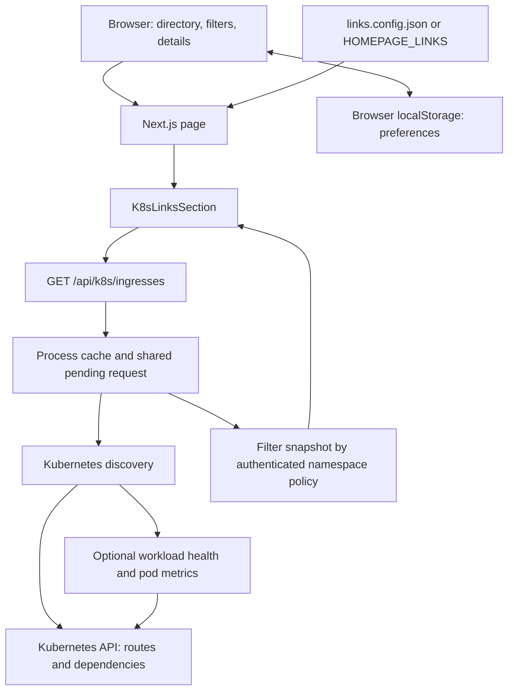
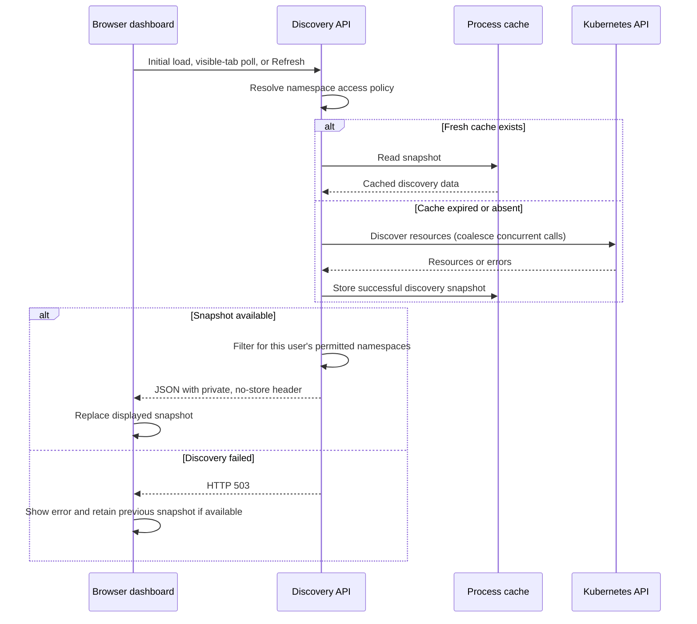
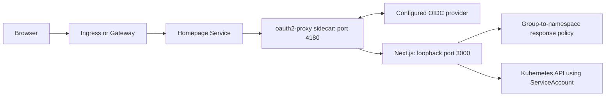

# Architecture

## Application and discovery flow

Discovery reads Ingress, HTTPRoute, TLSRoute, Gateway, and BackendTLSPolicy resources. It resolves route hosts, listeners, transport metadata, backends, annotations, and tool URLs into a common app representation.

When health is enabled, discovery also reads Services, EndpointSlices, Pods, Events, and workload controllers. Service selectors and endpoint pod references connect routes to pods; owner references connect pods to workload rollouts. Metrics require both health and metrics to be enabled.

The server namespace list limits Kubernetes requests and Helm RBAC. The label selector applies to discovered routes, so their dependent resources remain available for resolution. An empty namespace list enables cluster-wide discovery.

## Refresh and failure handling

Defaults are a 30-second browser refresh interval, a 15-second server cache, and a 10-second timeout per Kubernetes HTTP request. Manual Refresh uses the same cache. Each replica has its own cache; there is no distributed cache or background Kubernetes watch.

Optional APIs that are absent are skipped. Other discovery errors can produce warnings and partial results; total failure returns an error. The browser's retained snapshot is the fallback after a failed refresh, not a server-side stale-cache response.

## Optional OIDC access path

In Helm authentication mode, the Service points to the proxy and Next.js listens on loopback. The proxy supplies trusted user/group headers. The chart requires a NetworkPolicy with allowed ingress peers for this mode; configure those peers and trusted proxy CIDRs for the deployment.

An optional group policy grants the union of namespaces mapped to the user's groups. A user with no mapped namespaces receives HTTP 403. Every discovery response is filtered, including cache hits; health for backends outside permitted namespaces is withheld. The dashboard still reads Kubernetes using its own ServiceAccount, not user impersonation.

UI filters and `homepage.dev/hidden` affect presentation. Use server scope, RBAC, and the authenticated policy to restrict discovery access. Without a group policy, discovered results are not filtered per user.

## API surface

| Endpoint | Purpose |
| --- | --- |
| `/` | Server-rendered page and interactive app directory |
| `/api/config` | Resolved configured quick links |
| `/api/k8s/ingresses` | Discovered Ingress, HTTPRoute, and TLSRoute apps, diagnostics, and optional health |
| `/api/health/live` | Application liveness |
| `/api/health/ready` | Application readiness, independent of Kubernetes availability |

The discovery endpoint keeps its original `ingresses` name for all supported route kinds. Health probes describe the dashboard process, so a Kubernetes API outage does not make them fail.

## Source map

| Location | Responsibility |
| --- | --- |
| `app/page.tsx` | Page composition and configured quick links |
| `components/K8sLinksSection.tsx` | App directory, preferences, refresh, filters, and details |
| `components/AppIcon.tsx` | Supported app icons |
| `app/api/k8s/ingresses/route.ts` | Access policy, request coalescing, caching, and discovery responses |
| `lib/config.ts` | Quick-link parsing and validation |
| `lib/discovery-config.ts` | Discovery settings and defaults |
| `lib/kubernetes-discovery.ts` | Kubernetes clients, resource reads, and snapshot assembly |
| `lib/kubernetes-routes.ts` | Route extraction, listener matching, TLS evidence, and annotations |
| `lib/workload-health.ts` | Service-to-pod joins, rollout health, and metrics |
| `lib/namespace-access.ts` | Group policy validation and response filtering |
| `helm/homepage/` | Chart, scoped RBAC, optional OIDC, and deployment controls |
