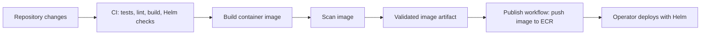

# Development and delivery

## Local development

Use `npm ci` to install the locked dependencies, then choose a preview:

| Command | Purpose |
| --- | --- |
| `npm run dev` | Start Next.js on port 3000; discovery can use local kubeconfig |
| `npm run dev:mock` | Start a fixture dashboard on port 3100 with a mock Kubernetes API |
| `npm run build` | Create the standalone production build |
| `npm start` | Serve the production build |

The mock preview exercises route discovery, TLS metadata, workload health, and metrics without requiring a cluster. Its data comes from `tests/fixtures/cluster.json` and the mock cluster helper under `tests/integration/`.

For quick links, edit `links.config.json` or supply `HOMEPAGE_LINKS`. For discovery and app annotations, use the [configuration guide](../DASHBOARD.md).

## Available checks

| Command | Coverage |
| --- | --- |
| `npm test` | Configuration, route extraction, namespace policy, and health helpers |
| `npm run test:integration` | Kubernetes SDK requests against a mock API |
| `npm run test:browser` | Playwright desktop/mobile dashboard interactions |
| `npm run lint` | ESLint checks |
| `npm run build` | Production compilation and type checking |
| `helm lint ./helm/homepage` | Chart validation |
| `helm template homepage ./helm/homepage` | Default Kubernetes resource rendering |

Browser tests require Playwright Chromium to be installed. Tests and fixtures cover simulated cluster behavior; they do not establish compatibility with every live controller, OIDC provider, or cluster policy.

## Packaging and delivery

The container uses a Node.js build stage and a non-root distroless runtime with Next.js standalone output. The publication workflow uses the validated image artifact and AWS OIDC credentials. Publishing an image does not deploy the chart.

## Helm deployment options

- Read-only discovery RBAC is cluster-wide by default, or scoped to configured namespaces. Health and metrics add permissions only when enabled; no Secret reads or Kubernetes writes are requested.
- Expose the dashboard with Ingress or a Gateway API HTTPRoute.
- Enable an OIDC proxy sidecar and group namespace mappings when authenticated access is required.
- Configure NetworkPolicy ingress peers, a PodDisruptionBudget, and horizontal autoscaling as needed.
- Use the dedicated liveness and readiness endpoints for application probes.

See the [Helm guide](../helm/README.md) and [full chart example](../helm/homepage/ci/full-values.yaml) for settings. Provider URLs and secrets in examples must be replaced for the deployment.

## Areas for further work

The current implementation provides a base for live provider integrations, endpoint reachability checks, historical metrics, and preferences shared across devices. These require additional integration or storage design. Validate route tags against the controllers actually installed in the target cluster, and exercise OIDC group claims and namespace policies with the chosen identity provider.
