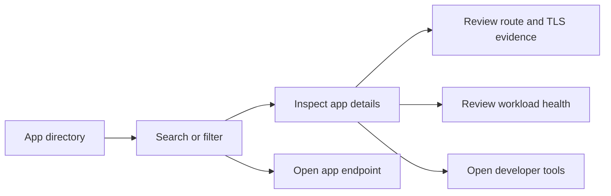

# Application overview

The homepage is a developer dashboard for finding applications in a Kubernetes cluster, understanding their routes, and inspecting their backend workloads. It combines configured quick links with a directory discovered from Kubernetes resources.

## What developers can do

| Area | Current behavior |
| --- | --- |
| App discovery | Discover Ingress, Gateway API HTTPRoute, and TLSRoute resources |
| Finding apps | Search names, endpoints, namespaces, teams, environments, and tags; filter by namespace, environment, tags, favorites, or attention |
| Presentation | Switch between cards and a table; use light, dark, or system theme |
| Route inspection | View frontend and backend transport tags, their evidence, and route acceptance issues |
| Backend health | Optionally inspect Service endpoints, pod readiness, restarts, images, rollout counts, and warning events |
| Resource usage | Optionally show current pod CPU and memory from the Kubernetes Metrics API |
| Developer tools | Open repository, runbook, CI, GitOps, metrics, logs, and tracing links supplied by annotations or templates |
| Personal preferences | Save favorites, recent detail views, theme, namespace, environment, and layout in browser storage |
| Refresh | Poll while the tab is visible, refresh manually, and retain the last successful browser snapshot after errors |
| Access | Optionally authenticate through an OIDC proxy and restrict discovered results by group-to-namespace policy |

Press `/` to focus search. App details include a copyable Kubernetes inspection command. Opening an app navigates to its endpoint; the dashboard itself does not forward application traffic.

## Typical workflow

## Technology and operating model

- Next.js 16 and React 19 provide the server page, API routes, and interactive dashboard.
- TypeScript defines shared data; Tailwind CSS 4 styles the UI.
- The Kubernetes Node client reads the cluster API with local kubeconfig in development or in-cluster credentials in production.
- There is no application database. Configuration comes from JSON, environment variables, and Kubernetes metadata. Discovery snapshots are cached in each server process; preferences stay in the browser.
- The container runs as a non-root user. Helm provides deployment, Service, discovery RBAC, and optional access and availability resources.

## Current boundaries

Transport tags describe declared configuration, not a verified TLS handshake or controller behavior. Workload health does not prove that an external endpoint is reachable.

Health and metrics are opt-in. Missing APIs, incomplete permissions, and dependencies outside the discovery scope can leave information unknown. Restarts are cumulative, warning events can outlive a failure, and resource metrics are current measurements rather than history.

Preferences are not shared between devices. Developer-tool integration currently provides links; it does not retrieve CI results, GitOps sync status, log streams, or traces. OIDC and tool providers must be configured for the target environment, and their live integration needs validation there.

See [architecture](./architecture.md) for the data and access boundaries, and [dashboard configuration](../DASHBOARD.md) for enabling these features.
