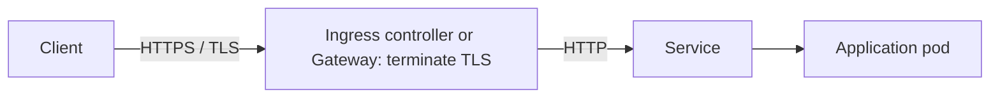
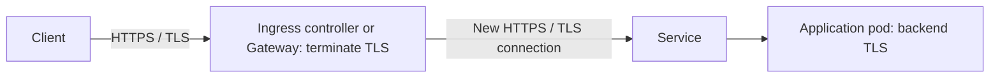
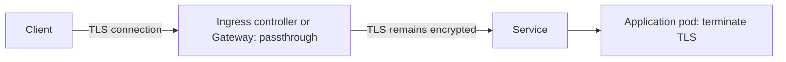

# Route transport and TLS tags

The dashboard presents frontend transport, TLS handling, and backend transport separately. Each app's details show the configuration evidence behind these tags. These are descriptions of configured intent, not active connection tests.

The following diagrams show typical application traffic. Ingress and Gateway route resources configure the controller; the dashboard reads those resources but is not part of this traffic path.

## TLS termination with an HTTP backend

The edge decrypts the client connection. Tags can show `HTTPS frontend`, `TLS termination`, and `HTTP backend` when the available configuration establishes each part. A TLS frontend alone does not establish the backend protocol.

## TLS termination with a secure backend

This is re-encryption: the client and backend connections have separate TLS sessions. Supported controller backend annotations or a matching Gateway BackendTLSPolicy provide backend evidence. The dashboard can show secure backend and re-encryption tags where both frontend termination and backend TLS are established.

## TLS passthrough

The edge forwards the TLS connection to the backend. A supported NGINX passthrough annotation or TLSRoute attached to a passthrough listener supplies evidence. Passthrough is not reported as edge termination or re-encryption.

## Where the evidence comes from

| Resource or setting | Used for |
| --- | --- |
| Ingress `spec.tls` and matching hostname | Frontend HTTPS and termination, unless supported passthrough configuration applies |
| NGINX `ssl-passthrough` annotation | Passthrough intent |
| NGINX or ALB `backend-protocol` annotation | Declared backend transport, including HTTPS or GRPCS where supported |
| Gateway listener protocol and TLS mode | Frontend transport and termination/passthrough mode |
| Route parent references and listener hostnames | Resolve the listener, endpoint host, and port |
| Matching BackendTLSPolicy | Backend TLS intent for targeted Services |
| Route status conditions | Acceptance and reference-resolution diagnostics |

Missing or unsupported evidence remains unknown. Mixed backends can have different transport settings. BackendTLSPolicy matching uses its target references; the dashboard does not verify policy acceptance or a live handshake.

## Endpoint and link behavior

- Ingress certificate wildcard matching and Gateway hostname wildcard matching follow different semantics; they are resolved separately.
- Unresolved listeners and incompatible hostnames produce issues rather than assumed HTTPS links.
- A TLSRoute is not assumed to carry HTTP. Its endpoint can be displayed as `tls://…`, with no browser link unless an explicit valid HTTP(S) `homepage.dev/url` is supplied.
- Wildcard hosts, regex paths, and some request-matching rules cannot be represented by a single browser URL. Details preserve their diagnostics; an explicit URL annotation can provide a useful entry point.

See [dashboard configuration](../DASHBOARD.md#tls-and-route-tags) for the full tag table and supported annotations.
